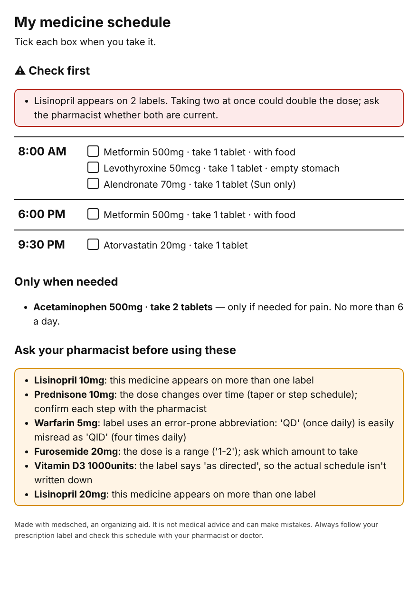
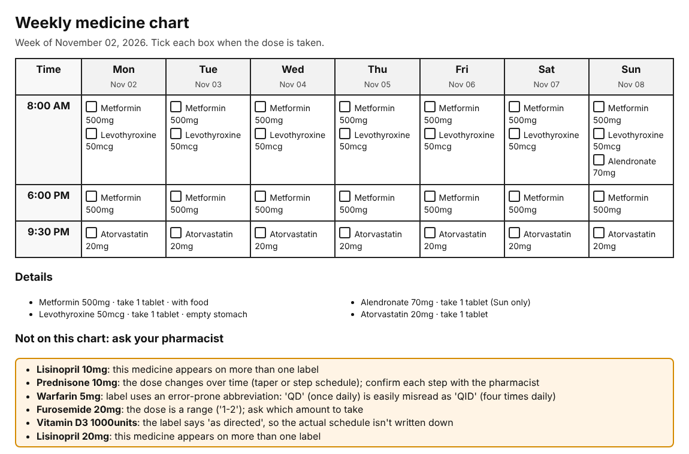

# medsched

[](https://github.com/kishoren18-hue/medsched/actions/workflows/ci.yml) [](LICENSE)

**Turns pharmacy labels into a large-print daily medicine schedule, and refuses to guess when a label is unclear.**

Older adults on several medications often manage them from a pile of bottles with small print. Tools that "read" labels for them have an obvious failure mode: a confident wrong answer. Misreading QD (once daily) as QID (four times daily), or 1.0 mg as 10 mg, are classic, well-documented medication errors.

medsched is designed around abstention. Anything it can parse cleanly goes on the schedule. Anything ambiguous goes to a clearly separated **"Ask your pharmacist"** list, with a plain-language reason. Its job is to organize, never to fill gaps.



*Generated from `examples/labels.txt` (made-up labels). Five of the eleven labels were deliberately written to be unsafe to auto-schedule.*

## What makes it abstain

| Situation | Example | Why it won't schedule it |
|---|---|---|
| Error-prone abbreviations (ISMP list) | `Take 1 tablet QD` | QD is easily misread as QID |
| Trailing or missing leading zeros | `1.0 mg`, `.5 mg` | can be read as ten times or one-tenth the dose |
| "As directed" | `Take as directed` | the schedule isn't actually written on the label |
| Dose ranges | `Take 1-2 tablets` | someone has to decide which |
| Tapers and step schedules | `4 tablets for 3 days, then 2…` | each step needs confirmation |
| Measurement-based dosing | `per sliding scale` | the tool won't calculate doses |
| Schedule exceeds the label's maximum | `2 tablets 4x daily` with "no more than 6 a day" | internal contradiction |
| Same drug on two labels | Lisinopril 10 mg and 20 mg | possible double dose |
| Unusual quantity | `Take 6 tablets` | worth a second look |
| Blurry photo | OCR confidence on the dose or directions line below 80% | can't trust what was read |

"As needed" medicines are listed separately with their daily maximum, never put on the clock.

## Quick start

```bash
pip install git+https://github.com/kishoren18-hue/medsched
medsched examples/labels.txt --html schedule.html --ics meds.ics
```

```
! Lisinopril appears on 2 labels. Taking two at once could double the dose; ask the pharmacist whether both are current.
08:00  Metformin 500mg · take 1 tablet · with food
08:00  Levothyroxine 50mcg · take 1 tablet · empty stomach
18:00  Metformin 500mg · take 1 tablet · with food
21:30  Atorvastatin 20mg · take 1 tablet
as needed  Acetaminophen 500mg · take 2 tablets (for pain)
ASK PHARMACIST  Warfarin: label uses an error-prone abbreviation: 'QD' (once daily) is easily misread as 'QID' (four times daily)
...
```

* `--html` writes a printable page with tick boxes in large type.
* `--week` writes a printable 7-day chart for caregivers and for filling a weekly pill organizer.
* `--ics` writes calendar reminders that import into Google Calendar, Apple Calendar or Outlook.
* `--wake --lunch --dinner --bed` anchor dose times to the person's actual routine; `--start` sets the first day.

### Weekly chart for caregivers



Every dose for the week on one landscape page. Medicines taken on specific days ("once a week on Sunday", "every Monday and Thursday") or every other day appear only on the days they're due, and the calendar file uses the matching weekly repeat rule.

### From label photos

```bash
pip install "medsched[ocr]"      # plus the tesseract program (brew/apt install tesseract)
medsched --image bottle1.jpg bottle2.jpg --html schedule.html
```

The OCR step scores confidence on the lines that matter (drug and strength, directions) and ignores lines like refill counts. In `examples/`, a sharp label photo reads at 95% confidence and is scheduled; a blurry one fails and goes to the pharmacist list. Regenerate both with `python examples/make_label_images.py`.

## Design principles

1. **Abstain, don't guess.** A missed schedule entry costs a phone call. A wrong one can hurt someone.
2. **Say why.** Every "ask" item comes with a reason a non-expert can act on.
3. **Large print, paper first.** The main output is a page you can put on the fridge.
4. **No data leaves the machine.** Everything runs locally, with no network calls.

## Limitations

* The parser handles common US label phrasing. Unusual wording usually ends up in the "ask" list, which is the intended failure mode, but it can still misparse.
* It doesn't check drug interactions or whether a dose is appropriate.
* **This is an organizing aid, not medical advice and not a medical device.** Always follow the prescription label and confirm the schedule with a pharmacist or doctor.

## Why I built this

I've volunteered at a senior living community for three years, and keeping track of several medicines is a constant source of stress for residents and their families. My research is on making AI systems know when they're uncertain, and this project applies that idea where it matters most: the most important feature is the list of things the tool refuses to decide.

## Development

```bash
pip install -e ".[dev]"
pytest -q        # 26 tests (the OCR test skips if tesseract isn't installed)
```

## Contributing

Issues and pull requests are welcome. See [CONTRIBUTING.md](CONTRIBUTING.md) for setup and ideas to start with, [CHANGELOG.md](CHANGELOG.md) for what's new, and [SECURITY.md](SECURITY.md) to report a problem privately. If you use this in research, GitHub's "Cite this repository" button (from [CITATION.cff](CITATION.cff)) gives a ready-made citation.

## License

MIT
